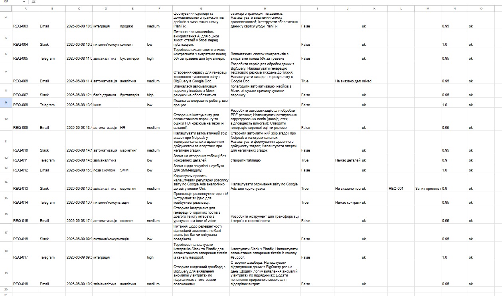

# AI Request Classifier

Класифікує вхідний потік запитів від внутрішніх команд (Slack / Telegram / Email,
вільна форма, українською) через LLM у структуровані поля.

**Вхід:** `data/input_requests.csv` — `id, channel, timestamp, raw_text`
**Вихід:** `output/output.json` (повний результат) + `output/report.md` (агрегати)

Артефакти реального прогону лежать у репозиторії — [`output/`](output/).

| | |
|---|---|
| Результат прогону | 18/18 класифіковано, 0 помилок, 3 хв 36 с |
| Тести | 35 юніт-тестів, без мережі |
| LLM | Gemini `gemini-3.5-flash-lite` через `google-genai` |
| Бонуси з ТЗ | ✅ async/батч · ✅ Docker · ✅ Google Sheets · ⬜ Telegram |

---

## Швидкий старт

```bash
python -m venv .venv
.venv/Scripts/pip install -r requirements.txt     # Linux/macOS: .venv/bin/pip

cp .env.example .env
# вписати у .env: GEMINI_API_KEY=<ключ з https://aistudio.google.com/apikey>

.venv/Scripts/python main.py
```

Прогін на 18 запитах займає ~3.5 хв — це не швидкість моделі, а свідоме
розтягування під квоту безкоштовного тіру (5 запитів/хв).

### Опції

| Прапорець | Дефолт | Що робить |
|---|---|---|
| `--input` | `data/input_requests.csv` | Вхідний CSV |
| `--output-dir` | `output` | Куди класти `output.json` і `report.md` |
| `--concurrency` | `3` | Скільки запитів до LLM паралельно |
| `--rpm` | `5` | Ліміт запитів на хвилину. `0` — без обмеження |
| `--model` | `gemini-3.5-flash-lite` | Модель Gemini |
| `--max-retries` | `1` | Скільки разів «самопочинюватись» на невалідний вивід |
| `--sheets` | вимкнено | Додатково записати результат у Google Sheet |

### Змінні оточення

| Змінна | Обовʼязкова | Навіщо |
|---|---|---|
| `GEMINI_API_KEY` | так | Ключ Gemini ([безкоштовно](https://aistudio.google.com/apikey)) |
| `GOOGLE_SHEETS_ID` | ні | ID таблиці з URL, для `--sheets` |
| `GOOGLE_SERVICE_ACCOUNT_JSON` | ні | Шлях до JSON сервісного акаунта |

Ключі беруться лише з `.env` / оточення і в репозиторій не потрапляють.

### Тести

```bash
.venv/Scripts/python -m pytest tests/ -v
```

Мережі не потребують — LLM замоканий, API-ключ не потрібен.

### Docker

```bash
docker build -t ai-request-classifier .
docker run --rm --env-file .env -v ${PWD}/output:/app/output ai-request-classifier
```

Перевірено end-to-end: образ збирається, контейнер із дефолтними аргументами
класифікує всі 18 запитів.

---

## Google Sheets (опційно)

Прапорець `--sheets` додатково вивантажує результат у таблицю — 15 колонок,
включно з `related_request_id` і причиною звʼязку.

**Перевірено на реальній таблиці:**
[відкрити результат](https://docs.google.com/spreadsheets/d/1xJDFTOtPiwvcaLdtuaR7ejtbtBuzchFJ-2wqmi8LodI/edit?usp=sharing)



Налаштування:

1. Створити проєкт у Google Cloud і увімкнути [Sheets API](https://console.cloud.google.com/apis/library/sheets.googleapis.com).
2. Створити service account → **Keys → Add key → JSON**, зберегти файл **поза** репозиторієм.
3. Розшарити таблицю на email із поля `client_email` цього JSON з правами **Editor**.
4. Вписати `GOOGLE_SHEETS_ID` і `GOOGLE_SERVICE_ACCOUNT_JSON` у `.env`.

Крок 3 — найчастіша точка провалу: без нього буде `PermissionError` навіть із
валідним ключем, бо для Google сервісний акаунт — сторонній користувач.

Помилки Google API навмисно **не** валять прогін: `output.json` і `report.md`
формуються незалежно від доступності Sheets.

---

## Схема даних

Обовʼязкові поля — прямо з ТЗ. Розширення додавав тільки там, де конкретний рядок
наданого CSV інакше обробляється неправильно:

| Поле | Навіщо |
|---|---|
| `language` (uk/en/mixed) | REQ-006 — англійський текст із українським хвостом «Хто може взятись?». Дешево дістати разом з рештою полів, корисно для маршрутизації. |
| `clarification_reason` | Якщо `needs_clarification=true`, людині одразу треба знати *чому*. Іде прямо в `report.md`. |
| `related_request_id` + `related_reason` | REQ-013 буквально каже «той самий звіт, що Оля просила в понеділок» (= REQ-001). Без цього дві однакові задачі виглядають як дві незалежні. |
| `confidence` | Самооцінка моделі, окремо від `needs_clarification`. `needs_clarification` — про *текст запиту* (розмитий чи ні), `confidence` — про впевненість моделі у *своїй* класифікації навіть чіткого тексту. Різні речі. |

Також додав категорію **`інше`**. У даних є REQ-008 («дякую за вчора, все працює
супер») — це не запит по суті, і мітити його як «поза скоупом» (що означає «не наша
тема») було б неточно. `інше` = «не є запитом взагалі»: подяка, привітання, шум.

### Чому `related_request_id` — окремий прохід

Перша версія передавала моделі список id сусідніх запитів прямо в промпті кожного
запиту. **Це не працювало**: за голим `REQ-001` неможливо здогадатись, що там
Google Ads — і REQ-013 не звʼязувався. Показувати ж повний інбокс у кожному з N
промптів — це O(N²) токенів.

Тому звʼязування винесене в окремий прохід (`GeminiClient.link_requests`): після
класифікації один виклик отримує список `id + категорія + short_summary` і шукає
дублікати. O(N) токенів, один додатковий запит на весь батч. Результат валідується
— вигадані моделлю id та звʼязки «сам на себе» відкидаються.

Це також чесніше архітектурно: звʼязок між запитами — властивість батчу, а не
окремого рядка. Тому поле живе в `ProcessedRequest`, а не в `LLMClassification`.

---

## Валідація та обробка невалідного виводу LLM

1. Запит іде з `response_mime_type="application/json"` і `response_schema`
   (Pydantic-модель передається в SDK напряму) — це вже сильно знижує шанс
   отримати не-JSON.
2. Незалежно від цього кожна відповідь проганяється через Pydantic. Structured
   output режиму моделі не довіряю наосліп.
3. Якщо парсинг або валідація провалились — **одна повторна спроба**: моделі
   показується її власна помилка з проханням виправити («self-repair»).
4. Якщо і друга спроба провалилась — рядок **не губиться**. Він потрапляє в
   `output.json` як `processing_status="fallback_error"`, `needs_clarification=true`,
   `category="інше"`, а `clarification_reason` містить технічну причину. Такі записи
   окремо виводяться в `report.md`, щоб людина одразу побачила, що розбирати руками.

Агрегати у звіті рахуються **лише по успішних записах** — інакше технічні заглушки
fallback-у (`інше`/`medium`) мовчки роздували б статистику.

### Чотири рівні стійкості

Розділені за класом проблеми, а не звалені в один retry:

| Рівень | Що ловить | Реакція |
|---|---|---|
| Rate limiter | квота 5 запитів/хв | рознесення викликів у часі |
| Backoff | хвилинний 429, 5xx, мережа | пауза, яку назвав сам сервер |
| Circuit breaker | **денна** квота | миттєве падіння, без марних викликів |
| Self-repair | невалідний JSON / Pydantic | показати моделі її помилку |

---

## Де рішення ламається / обмеження

Нижче — те, на що я реально наштовхнувся, доводячи це до робочого стану, а не
гіпотетичний список.

- **Денна квота ≠ хвилинна.** Найдорожчий урок. Gemini у *всіх* 429 повертає
  `retryDelay` (напр. `25s`) — навіть коли вичерпана квота на добу. Перша версія
  слухала цю пораду наосліп і зависла на 14 хвилин, безнадійно повторюючи запити.
  Тепер денна квота розпізнається по `quotaId` (`PerDay`), вмикає circuit breaker,
  і `main.py` явно попереджає, що результат неповний. **Не закрито**: часткові
  результати не докласифіковуються автоматично — це треба запускати руками.
- **Вибір моделі жорсткіший, ніж здається.** `gemini-2.5-flash` віддає 404 «no
  longer available to new users». `thinking_budget=0` на Gemini 3.x — 400
  INVALID_ARGUMENT, працює тільки `thinking_level="low"`. Конфіг, скопійований зі
  старого прикладу, впаде на кожному запиті.
- **TLS-інспекція.** У мережах з корпоративним проксі/антивірусом `certifi` не
  містить локального кореня, і всі виклики падають з `CERTIFICATE_VERIFY_FAILED`.
  Закрито через `truststore` (перевірка йде по сховищу ОС). Перевірку сертифікатів
  при цьому **не** вимикав — це було б тим самим, що працювати без TLS.
- **Невалідний вивід LLM**: закрито (retry + fallback-запис). Не закрито: якщо
  модель *валідно* парситься, але змістовно помиляється (не та категорія) — це
  автоматично не ловиться. Потрібен eval-набір із golden-прикладами.
- **Великий обсяг**: пайплайн асинхронний з семафором і rate-limiter-ом, тому 18
  запитів чи 1800 — той самий код. Але немає персистентності: якщо процес впаде на
  запиті 1500 з 2000, усе почнеться з нуля. Для реального обсягу — писати проміжні
  результати в SQLite і повторювати лише недороблені id.
- **Недетермінізм**: `temperature=0.0` знижує варіативність, але не гарантує
  однаковість між викликами. Заміряв: два незалежні прогони на тому самому CSV
  розійшлися в **1 полі з 90** (98.9% збіг) — у REQ-010 `target_department` то
  `null`, то `маркетинг`. Категорії й пріоритети збіглися повністю. Тобто
  «пливуть» саме межові випадки, де відділ із тексту прямо не названий. Для
  стабільності — кеш по хешу `raw_text`.
- **Вартість токенів**: на 18 запитах — у межах безкоштовного тіру. Системний
  промпт домінує у вхідних токенах. При масштабуванні: (а) кеш по хешу тексту,
  (б) стиснути системний промпт, (в) batch API замість online-викликів.
  `thinking_level="low"` вже прибирає зайві reasoning-токени — для класифікації за
  готовою схемою вони не потрібні.
- **`related_request_id`** працює в межах одного батчу. У реальному потоці
  (Slack/Telegram у реальному часі) потрібен пошук по накопиченій історії через
  embeddings, а не по «сусідах у файлі».
- **`--sheets` вимагає повного перепрогону.** Щоб оновити таблицю, зараз треба
  наново класифікувати всі запити. Логічніше було б уміти вивантажувати вже
  готовий `output.json` — не встиг.

---

## Що зробив би далі

1. **Eval-набір**: 20–30 розмічених вручну прикладів + скрипт, що рахує accuracy
   після кожної зміни промпту. Зараз якість промпту не виміряна кількісно — лише
   звірена вручну на 18 запитах за контрольними кейсами.
2. **Персистентність**: SQLite замість «усе в памʼяті» — щоб великий обсяг
   оброблявся інкрементально й відновлювався після збоїв та вичерпаної квоти.
3. **Дедублікація через embeddings** поверх `related_request_id` — кластеризація за
   схожістю `short_summary`, а не лише явні згадки в тексті.
4. **Telegram-дайджест**: `build_report()` уже повертає готовий текст, лишається
   окремий модуль-відправник.
5. **CI**: GitHub Actions з `pytest` на кожен push — тести не залежать від мережі,
   тож це дешево.

---

## Структура

```
main.py              CLI: аргументи, env, оркестрація, запис артефактів
src/schema.py        Pydantic-контракт: LLMClassification + ProcessedRequest
src/llm_client.py    Gemini: промпт, structured output, retry, backoff, квоти
src/pipeline.py      Читання CSV, async-обробка, fallback, прохід звʼязування
src/report.py        Агрегація у Markdown-звіт
src/sheets.py        Опційний експорт у Google Sheet
tests/               Юніт-тести з fake-клієнтом, без мережі
data/                Вхідний CSV із завдання
output/              Артефакти реального прогону
```
